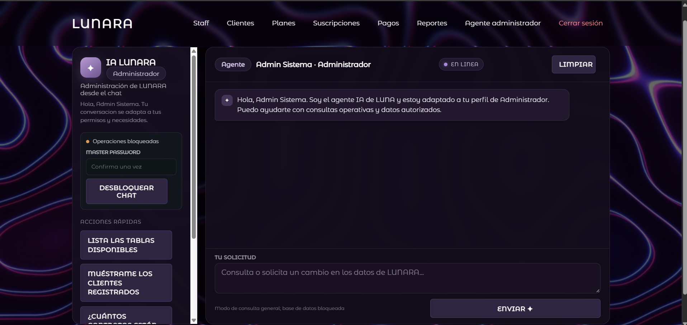
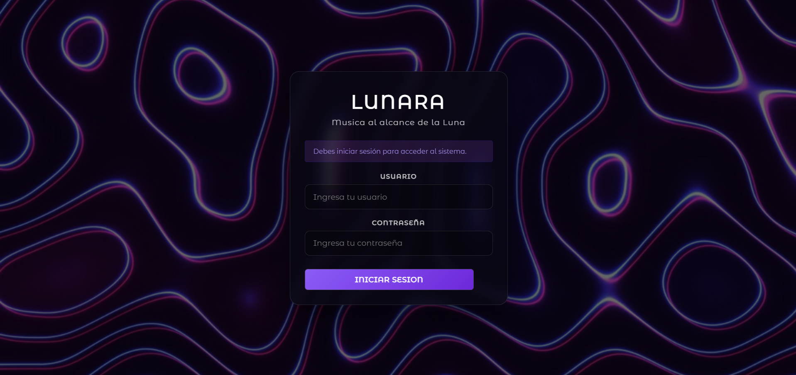
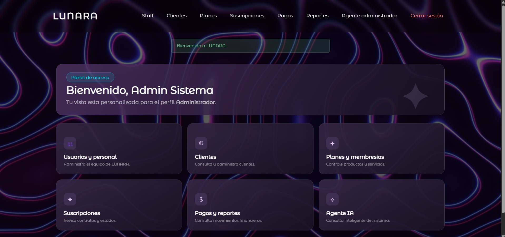
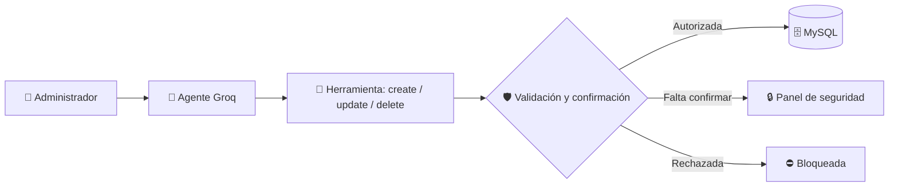

<div align="center">

# 🌙 Lunara + Agente IA

### Sistema de membresías con login, roles y un asistente de IA que administra la base de datos

<br>


<br>



</div>

---

## ✨ ¿Qué es?

Evolución de [Lunara](https://github.com/AreR9/lunara-membresias): además del CRUD de clientes, planes, suscripciones y pagos, incorpora **inicio de sesión con roles** y un **agente de IA** (Groq) que permite al administrador consultar y modificar la base de datos con lenguaje natural, con varias capas de confirmación.

Proyecto universitario desarrollado con la guía de mi profesor.

## 📸 Capturas

<div align="center">

### 🔐 Inicio de sesión


<br><br>

### 🏠 Pantalla principal


<br><br>

### 🤖 Agente IA


</div>

---

## 🎯 Características

| | Característica |
|:---:|:---|
| 🔐 | **Login con sesiones** y panel distinto según el rol |
| 👥 | **3 roles:** Administrador, Empleado y Cliente |
| 🤖 | **Agente IA** que consulta, crea, edita y elimina registros mediante herramientas |
| 🛡️ | **Solo el administrador** puede usar el agente |
| 🔓 | **Master Password** para desbloquear el agente antes de pedir cambios |
| 🗑️ | **Destructive Password** para borrar 5 o más registros a la vez |
| ⏳ | **Bloqueo temporal** tras intentos fallidos de borrado masivo |
| 🧱 | **Consultas parametrizadas** y validación de tablas permitidas |
| 🔑 | **Token CSRF** en el panel del agente |

## 🔄 Cómo trabaja el agente



La autorización y el esquema se comprueban **en el servidor**, aunque el modelo pida otra cosa.

## 👥 Roles

| Rol | Vista | Agente IA |
|:---|:---|:---:|
| Administrador | Panel completo | ✅ |
| Empleado | Panel de operaciones | ❌ |
| Cliente | Panel de consulta | ❌ |

## 🛠️ Tecnologías

| Capa | Tecnología |
|:---|:---|
| Backend | Python · Flask |
| Base de datos | MySQL (`mysql-connector-python`) |
| IA | Groq (`openai/gpt-oss-120b` por defecto) |
| Frontend | HTML · CSS · Jinja2 |
| Configuración | `python-dotenv` |

## 🚀 Instalación

```bash
git clone https://github.com/AreR9/lunara-agente-ia.git
cd lunara-agente-ia

python -m venv venv
venv\Scripts\activate
pip install -r requirements.txt

copy .env.example .env
```

Completa el `.env`:

```env
DB_HOST=localhost
DB_USER=root
DB_PASSWORD=tu_contraseña
DB_NAME=sistema_membresias
FLASK_SECRET_KEY=una_clave_larga_y_aleatoria
GROQ_API_KEY=tu_clave_de_groq
GROQ_MODEL=openai/gpt-oss-120b
MASTER_PASSWORD=una_contraseña
DESTRUCTIVE_PASSWORD=otra_contraseña_distinta
```

> 💡 `MASTER_PASSWORD` y `DESTRUCTIVE_PASSWORD` deben ser **distintas** entre sí.

Obtén una clave de Groq en [console.groq.com](https://console.groq.com). Luego ejecuta:

```bash
python app.py
```

> ⚠️ El repositorio **no incluye la base de datos** ni sus datos. Necesitas una base MySQL llamada `sistema_membresias` con las tablas del sistema.

## 🔐 Seguridad

- Ninguna clave ni contraseña de configuración está en el código: todo viene del `.env`, que no se sube.
- Las acciones destructivas pasan por confirmación y bloqueo temporal.
- El agente no puede eliminar el usuario con el que inició sesión.

## 🔮 Próximas mejoras

- [ ] Guardar las contraseñas de los usuarios con hash (`werkzeug.security`)
- [ ] Pruebas automatizadas
- [ ] Script para crear la base de datos y datos de ejemplo

## 📁 Estructura

```
lunara-agente-ia/
├── 📂 capturas/       → imágenes del README
├── 📂 static/         → CSS, video y póster de fondo
├── 📂 templates/      → login, agente, paneles por rol y formularios
├── 📄 app.py          → rutas, sesiones, roles y panel del agente
├── 📄 agent_ai.py     → agente Groq, herramientas y reglas de seguridad
├── 📄 db.py           → conexión a MySQL
├── 📄 requirements.txt
└── 📄 .env.example
```

---

<div align="center">

### 👩‍💻 Desarrollado por **Areli Reynoso**

Con la guía del profesor Erick.

[](https://github.com/AreR9/lunara-agente-ia)

</div>
